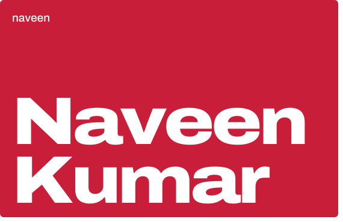
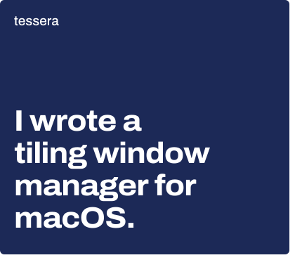
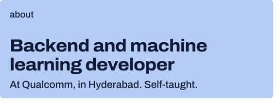
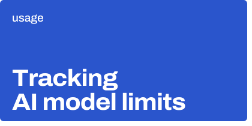

## Selected work

### [Tessera](https://github.com/Spidey03/tessera)
A tiling window manager for macOS. Each display gets its own binary space partition tree, and windows move through the Accessibility API, so there are no Space-switching animations to wait for. `⌘⌥⏎` tiles everything.

`Swift` `Python` · [Releases](https://github.com/Spidey03/tessera/releases)

### [Model usage tracker](https://github.com/Spidey03/model-usage-tracker)
Shows how much of each AI provider’s rolling limit is left in the macOS menu bar, and forecasts whether the current pace will hit the limit before the reset.

`Python` `macOS`

## More projects

| Project | What it does | Built with |
|:--|:--|:--|
| [skills](https://github.com/Spidey03/skills) | Workflow instructions for coding agents, with an installer | JavaScript |
| [doc-genie](https://github.com/Spidey03/doc-genie) | Pulls answers and insights out of PDF documents | Jupyter |
| [gemini_vidwise](https://github.com/Spidey03/gemini_vidwise) | Explains what happens in a video using Gemini | Jupyter |
| [depression_prediction](https://github.com/Spidey03/depression_prediction) | Kaggle work on predicting depression across age groups | Jupyter |
| [onesite](https://github.com/Spidey03/onesite) | Finds and lists plots by location and owner | Django |
| [imdb_project](https://github.com/Spidey03/imdb_project) | Movie and cast listings with charts of IMDB data | Django |
| [restaurant-app](https://github.com/Spidey03/restaurant-app) | Orders and bill payments for a restaurant | Django |

## About

I build backend systems with Django and explore machine learning. I write clean code, make mistakes, learn, and ship things that matter.

> I do copy and paste. I make mistakes. I learn. I constantly move on. **I repeat.**

- **Backend:** Python, Django, Go, PostgreSQL
- **ML:** TensorFlow, scikit-learn
- **Apps:** Swift, JavaScript
- **Infrastructure:** Docker, AWS, GitHub Actions

## Let’s build something together

[LinkedIn](https://www.linkedin.com/in/naveen0003) · [Twitter](https://twitter.com/iM_Nvnkumar) · [Kaggle](https://www.kaggle.com/spidey03) · [Spotify](https://open.spotify.com/user/naveenspidey?si=ab63e2b20a8b49a3)
